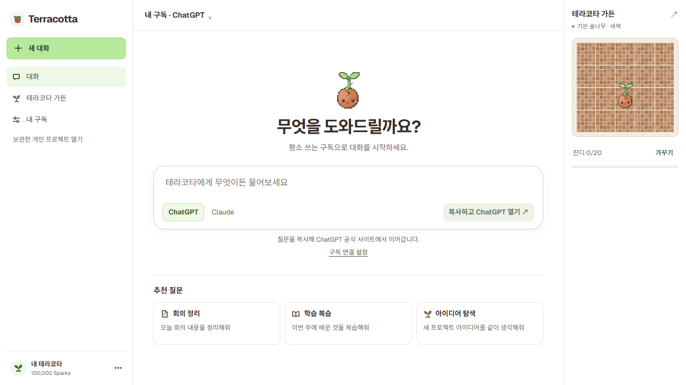
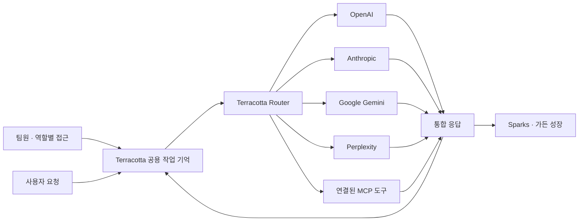

<p align="center">
  
</p>

<h1 align="center">Terracotta</h1>

<p align="center">
  GPT, Claude, Gemini 사이에서 프로젝트 대화를 이어가고, 마친 작업으로 픽셀 정원을 가꾸는 개인 AI 작업실입니다.
</p>

<p align="center">
  <a href="#로컬에서-실행하기">로컬에서 실행하기</a>
  ·
  <a href="./DEPLOYMENT.md">Vercel·자체 도메인 배포</a>
  ·
  <a href="./SELF_HOSTING.md">Docker 운영 가이드</a>
  ·
  <a href="#로드맵">로드맵</a>
</p>



## 처음 사용하는 분께

1. **대화를 시작합니다.** 첫 화면의 대화 입력창에 질문을 적어 보내세요. 프로젝트를 만들면 기본 모델과 작업 지침을 지정할 수 있습니다. 실제 답변을 받으려면 서버에 사용할 공급사의 API 키가 하나 이상 설정되어 있어야 합니다.
2. **다른 모델로 이어갑니다.** 작업 중 GPT, Claude 또는 Gemini를 선택하면 새 모델이 같은 대화의 기록과 도구 실행 요약을 이어받습니다. 검색에는 Perplexity를 연결할 수 있습니다.
3. **정원을 가꿉니다.** 답변이 완료되면 Sparks와 성장 단계가 쌓입니다. Sparks로 5×4 정원에 잔디를 심고, 장식을 구입해 원하는 자리에 배치하세요.

개인 운영 주소를 열면 새싹 화분이 있는 로그인 화면이 나옵니다. **Vercel로 로그인**을 누르면 등록된 소유자 계정으로 작업실에 들어갈 수 있습니다. GitHub의 `codex/shared-model-context`가 운영 브랜치이며, 이 브랜치에 푸시해 빌드가 성공하면 같은 주소에 반영됩니다. [배포 및 로그인 설정](./DEPLOYMENT.md)

| 데이터 | 개인 Vercel 배포 | Docker 셀프호스팅 |
| --- | --- | --- |
| 대화, 프로젝트, 도구 실행 기록, 사용량 원장 | 연결한 Turso 데이터베이스 | `terracotta-data` 볼륨의 로컬 D1 |
| 잔디, 장식 배치, 나무 성장, Sparks | 접속한 주소의 브라우저 로컬 저장소 | 접속한 주소의 브라우저 로컬 저장소 |

## 현재 구현된 것

- **멀티 모델 라우터** — OpenAI, Anthropic, Google Gemini, Perplexity, Higgsfield 연결 상태와 사용량 예산을 한곳에서 관리합니다.
- **GPT · Claude · Gemini 공용 작업 기억** — 대화·최종 결과·도구 기록을 작업 세션에 저장해 모델을 바꿔도 같은 작업을 이어갑니다.
- **프로젝트 워크스페이스** — 프로젝트마다 대화, 기본 모델, 작업 지침, 연결할 컴퓨터와 루트 폴더를 나눠 관리합니다. 사이드바에서 프로젝트를 바꾸면 최근 대화와 컨텍스트도 함께 전환됩니다.
- **프로젝트 파일 도구** — 연결된 컴퓨터의 파일 목록·읽기·검색·저장과 Git 변경점 확인을 구조화된 도구로 제공합니다. 읽기 전용/읽기·쓰기 및 터미널 승인 정책을 프로젝트별로 설정합니다.
- **팀 작업 공유와 인계** — 사용자별 로그인을 구성한 자체 호스팅 환경에서 작업별 보기·편집 권한을 나누고, 인계 메모와 함께 같은 AI 작업 기록을 넘겨받습니다.
- **자동 오케스트레이터** — 질문을 분석해 모델과 연결된 MCP 도구를 선택하고, 읽기 도구는 자동 실행한 뒤 결과를 다시 모델이 검증·정리합니다.
- **안전한 실행 승인** — 메시지 전송·수정·삭제처럼 외부 상태를 바꾸는 작업은 서비스·도구·인자를 보여준 뒤 사용자 승인으로만 실행합니다.
- **자동 모델 레지스트리** — GPT-6.2 Sol, Claude Fable 5.2, Claude Sonnet 5.5, Gemini 4 Hydrogen을 포함하며, 연결된 공급사의 모델 목록을 확인해 우선순위를 갱신합니다.
- **OpenAI 실행 경로** — 기본 모델은 GPT-6.2 Sol입니다. Responses API에서 작업별 추론 강도와 도구 호출 상한을 설정하고, `store: false`로 요청합니다.
- **개인화된 모델 우선순위** — 최신 모델, GPT, Claude, Gemini 중 사용자가 직접 기본 순서를 정합니다.
- **모델 연구소** — 최신 모델의 장단점, 잘하는 작업, LM Arena 카테고리별 순위와 Artificial Analysis 지표를 출처와 함께 비교합니다.
- **5×4 비트맵 가든** — 흙에서 시작해 잔디를 한 칸씩 심고, 같은 잔디 20칸을 채우면 하나의 이어진 정원이 됩니다.
- **자유 배치 가드닝** — 장식과 Terracotta 캐릭터를 타일에 묶이지 않은 좌표로 드래그하고 기기에 저장합니다.
- **가드닝 스토어** — 꽃, 장식, 친구, 도구, 텃밭과 성장 모습이 다른 나무를 Sparks로 구매합니다.
- **MCP Hub** — GitHub, Notion, Figma, Linear, Google Drive, Slack 등 다양한 MCP 연결을 검색하고 관리합니다.
- **보안 중심 MCP OAuth** — PKCE S256, AES-GCM 토큰 암호화, HTTPS 전용 연결과 내부 네트워크 주소 차단을 적용합니다.
- **구독 프로토타입** — 모델·검색·이미지·영상 사용량을 함께 고려한 크레딧 플랜과 월간 공급사 비용 가드를 제공합니다.
- **한 명령 셀프호스팅** — Docker Compose로 웹 버전과 같은 Worker 앱을 실행하고 D1·MCP 암호화 키를 전용 볼륨에 보존합니다.
- **Windows·macOS·Linux 로컬 에이전트** — 배포 사이트와 각 컴퓨터를 아웃바운드로 연결하고, 승인한 명령만 PowerShell·zsh·bash에서 작업 폴더 안에 실행합니다.
- **운영 배포** — 개인 Vercel에서는 Next.js와 Turso를 사용합니다. 자체 도메인에서는 Docker, Caddy HTTPS, GitHub 팀 로그인과 영구 볼륨을 함께 구성합니다.

### 픽셀 아트 디자인 원칙

채팅 첫 화면은 흰 바탕에 작은 화분 마스코트와 대화 입력창을 중심으로 구성합니다. 잎의 연두색과 흙의 갈색을 포인트로 씁니다. 화분과 정원의 식물·장식에는 기존 픽셀 아트를 사용하고, 작은 원본을 확대할 때는 최근접 이웃 보간이나 CSS `image-rendering: pixelated`로 윤곽을 보존합니다. [가든 에셋](./public/assets/garden)

## 제품 흐름



## 에이전트 오케스트레이션

Terracotta는 다음 순서로 대화 기록, 모델 호출, 도구 실행을 관리합니다. [오케스트레이터 구현](./lib/terracotta-orchestrator.ts)

1. **라우팅** — 과제 분류(general/research/creative) 후 선호 설정과 최신 모델 랭킹으로 플래너 선택. 리서치성 요청은 Perplexity로 위임
2. **도구 루프** — 연결된 MCP 도구를 플래너가 호출. 쓰기(write) 위험 도구는 즉시 실행하지 않고 **승인 대기**로 전환(만료 시간 포함), 요청당 도구 호출 상한 적용
3. **교차 검토** — "교차 검증", "second opinion" 류 요청이면 **다른 공급사의 백업 모델**이 초안의 사실 오류·누락을 검토해 최종본 작성 (`reviewedBy`로 표기)
4. **컨텍스트 인계** — 모델이 바뀌면 사용자에게 보인 대화·최종 출력·검증된 도구 요약만 공용 세션에서 넘기며, 비공개 추론 과정은 전달하지 않음
5. **팀 인계** — 소유자는 이메일별 보기·편집 권한을 관리하고, 편집 가능한 팀원끼리 인계 메모와 현재 작업 기록을 주고받음
6. **프로젝트 실행** — 현재 프로젝트의 작업 지침과 모델 선호를 컨텍스트에 포함하고, 지정한 컴퓨터·루트 폴더의 허용된 파일 도구만 모델에 노출
7. **기록** — 모든 단계가 orchestration trace(route/tool/review/handoff)로 남고, 파일 작업은 프로젝트 activity에, 비용은 사용량 원장에 기록

다중 에이전트의 협업과 검증을 따로 실험하려면 [agent-orchestra](https://github.com/hyunaeee/agent-orchestra)를 참고하세요.

## 라우팅 정책별 예상 비용

다음은 GPT-5.6 Sol을 사용하던 시점의 비용 추정치입니다. 일반·리서치·창작으로 미리 분류한 요청을 8개씩 준비하고, 요청마다 정해 둔 입출력 토큰 수에 스크립트의 모델 단가를 곱했습니다. 실제 청구액은 사용량과 공급사 단가에 따라 달라집니다.

| 정책 | 요청 한 건당 예상 비용 (USD) |
| --- | ---: |
| 자동 선택 · 최신 모델 우선 | 0.01047 |
| 자동 선택 · Claude 우선 | 0.02129 |
| GPT-5.6 Sol 고정 | 0.01155 |
| Claude Fable 5 고정 | 0.02887 |
| Claude Sonnet 5 고정 | 0.00866 |

`node bench/routing-bench.mjs`로 API 호출 없이 계산을 재현할 수 있습니다. [계산 방식](./bench/routing-bench.mjs) · [정책별 결과](./bench/results.json)

## 기술 구성

- **개인 Vercel 배포** — Next.js App Router, React, Turso(libSQL), Sign in with Vercel
- **로컬 개발·Docker** — Node.js 24+, vinext, Vite, Cloudflare Workers 런타임과 로컬 D1
- **공통 기능** — Drizzle 스키마, 공급사별 모델 레지스트리와 사용량 원장, OpenAI Responses API, Streamable HTTP MCP와 OAuth/PKCE

## 로컬에서 실행하기

운영 중인 코드와 같은 브랜치를 내려받습니다.

```bash
git clone --branch codex/shared-model-context https://github.com/hyunaeee/terracotta.git
cd terracotta
```

### 수정하면서 개발하기

Node.js 24 이상과 npm이 필요합니다. 프로젝트 루트에서 `.env.example`을 `.env`로 복사한 뒤 사용할 공급사의 키를 입력하세요.

```bash
npm ci
npm run dev
```

터미널에 표시된 주소를 열면 코드 변경이 개발 화면에 반영됩니다.

### Docker로 셀프호스팅

`.env.selfhost.example`을 `.env`로 복사해 사용할 키를 입력한 뒤 프로젝트 루트에서 실행합니다.

```bash
docker compose up -d --build
```

기본 접속 주소는 [localhost:3000](http://localhost:3000)입니다. `terracotta-data` 볼륨에는 로컬 D1 데이터와 최초 실행 때 생성한 MCP 토큰 암호화 키가 저장됩니다. [셀프호스팅 및 백업](./SELF_HOSTING.md) · [자체 도메인과 GitHub 팀 로그인](./DEPLOYMENT.md#docker-배포)

### 서버 환경 변수

| 변수 | 용도 |
| --- | --- |
| `OPENAI_API_KEY` | OpenAI 모델 및 모델 레지스트리 연결 |
| `ANTHROPIC_API_KEY` | Claude 모델 연결 |
| `GEMINI_API_KEY` | Google Gemini 모델·도구 호출 및 모델 레지스트리 연결 |
| `PERPLEXITY_API_KEY` | 웹 검색·리서치 모델 연결 |
| `HIGGSFIELD_MCP_CONNECTED` | Higgsfield 연결 상태 표시용 플래그. 실제 도구 호출에는 인증된 MCP 연결이 필요합니다. |
| `TERRACOTTA_MONTHLY_BUDGET_USD` | 월간 공급사 비용 한도 |
| `MCP_TOKEN_ENCRYPTION_KEY` | MCP OAuth 토큰 암호화용 32바이트 base64 키 |
| `TURSO_DATABASE_URL`, `TURSO_AUTH_TOKEN` | 개인 Vercel 배포의 데이터베이스 주소와 인증 토큰 |
| `TERRACOTTA_VERCEL_CLIENT_ID`, `TERRACOTTA_VERCEL_OWNER_ID` | Vercel 로그인 앱의 Client ID와 작업실을 열 수 있는 단일 소유자의 ID |
| `TERRACOTTA_TRUST_AUTH_HEADERS` | 신뢰 가능한 로그인 프록시가 있을 때만 셀프호스트 팀 이메일 식별 활성화 |

Docker 외의 환경에서 MCP 토큰 암호화 키가 필요하면 다음 명령으로 생성할 수 있습니다.

```bash
node -e "console.log(require('crypto').randomBytes(32).toString('base64'))"
```

API 키와 데이터베이스 토큰은 서버 환경 변수에만 저장합니다. Vercel에서는 Production 환경에 등록한 뒤 다시 배포하고, MCP 암호화 키는 배포 간에 같은 값을 유지하세요.

## 주요 명령

| 명령 | 설명 |
| --- | --- |
| `npm run dev` | 로컬 개발 서버 실행 |
| `npm run build` | vinext Worker 빌드 생성 |
| `npm run build:vercel` | Vercel용 Next.js 빌드 생성 |
| `npm test` | 빌드 및 핵심 제품 동작 검증 |
| `npm run lint` | 코드 정적 검사 |
| `npm run db:generate` | Drizzle 마이그레이션 생성 |
| `docker compose up -d --build` | 셀프호스트 앱 빌드 및 백그라운드 실행 |
| `docker compose --env-file .env.production -f compose.production.yaml up -d --build` | 자체 도메인 운영 배포 |

## 프로젝트 구조

```text
app/                     UI와 API routes
lib/terracotta-router.ts 모델 레지스트리·라우팅·비용 기록
lib/mcp-hub.ts           MCP 연결·OAuth·도구 호출
lib/work-context.ts      공급사 중립 작업 세션·컨텍스트 인계
lib/workspace-projects.ts 프로젝트·컴퓨터·파일 권한·활동 기록
lib/local-agent.ts       로컬 에이전트 페어링·구조화된 파일 작업 큐
db/                      D1과 Turso가 공유하는 SQLite 스키마
drizzle/                 데이터베이스 마이그레이션
public/assets/garden/    개별 비트맵 가드닝 아이템
public/assets/mcp/       MCP 서비스 브랜드 아이콘
docker/                  셀프호스트 초기화·헬스체크
tests/                   제품 동작 검증
```

## 로드맵

- **격리된 Git worktree 실행** — 각 에이전트의 패치를 분리한 뒤 테스트와 검토를 거쳐 선택적으로 반영
- **개인 모델 성과 라우팅** — 테스트 통과율, 패치 수락률, 비용과 속도를 바탕으로 사용자별 최적 모델 선택
- **암호화된 개인 메모리** — 사용자가 승인한 데이터만 장기 기억으로 저장
- **가든 동기화** — 여러 기기에서 성장 단계와 꾸민 정원을 이어서 사용

## 현재 상태

Terracotta는 제품 방향과 핵심 상호작용을 검증하는 초기 프로토타입입니다. 실제 모델 응답, MCP OAuth, 비용 기록에는 각 공급사의 공식 API 또는 계정 인증이 필요합니다. 소비자용 AI 구독과 공급사 API 사용료는 서로 별개일 수 있습니다.

## License

Copyright © 2026 Terracotta. 현재 별도의 오픈소스 라이선스는 부여하지 않습니다.
