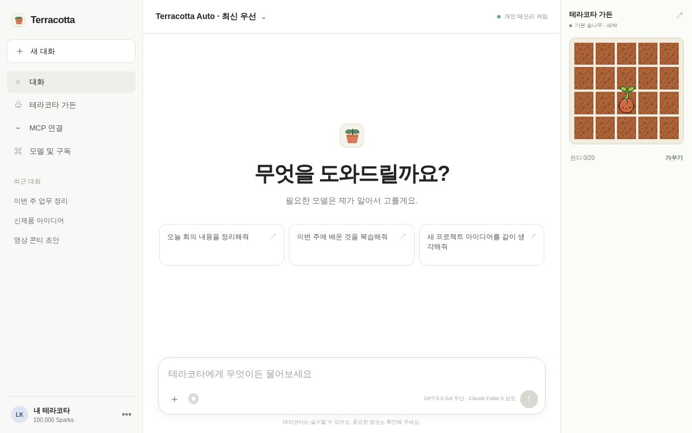
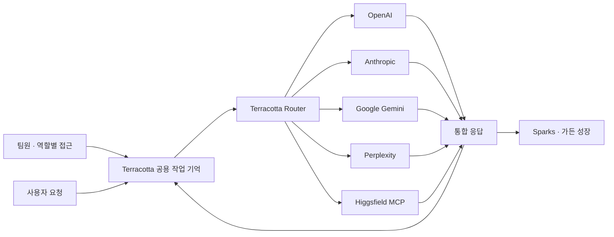

<p align="center">
  
</p>

<h1 align="center">Terracotta</h1>

<p align="center">
  <strong>가장 잘하는 AI를 골라 쓰고, 사용할수록 나만의 지식 정원이 자라는 개인 AI 작업실.</strong>
</p>

<p align="center">
  <a href="./DEPLOYMENT.md">Production deployment</a>
  ·
  <a href="./SELF_HOSTING.md">Self-host with Docker</a>
  ·
  <a href="#로컬에서-실행하기">Run locally</a>
  ·
  <a href="#로드맵">Roadmap</a>
</p>



## Terracotta란?

Terracotta는 GPT, Claude, Gemini, Perplexity, Higgsfield처럼 서로 다른 강점을 가진 AI를 한 화면에서 다루기 위한 멀티 모델 AI 동반자입니다. 사용자는 `최신 모델 우선`, `GPT 우선`, `Claude 우선`, `Gemini 우선` 중 하나를 고르고, Terracotta는 작업 성격에 맞는 모델을 조합합니다.

완료한 작업과 AI 사용량은 **Sparks**로 쌓입니다. Sparks로 5×4 비트맵 가든에 잔디를 한 칸씩 심고, 아이템을 구매해 자유롭게 배치하며, 중앙의 Terracotta 캐릭터를 씨앗에서 큰 나무로 키울 수 있습니다.

## 현재 구현된 것

- **멀티 모델 라우터** — OpenAI, Anthropic, Google Gemini, Perplexity, Higgsfield 연결 상태와 사용량 예산을 한곳에서 관리합니다.
- **GPT · Claude · Gemini 공용 작업 기억** — 대화·최종 결과·검증된 도구 기록을 Terracotta 소유의 D1 세션에 저장해 모델을 바꿔도 같은 작업을 이어갑니다.
- **프로젝트 워크스페이스** — 프로젝트마다 대화, 기본 모델, 작업 지침, 연결할 컴퓨터와 루트 폴더를 나눠 관리합니다. 사이드바에서 프로젝트를 바꾸면 최근 대화와 컨텍스트도 함께 전환됩니다.
- **프로젝트 파일 도구** — 연결된 컴퓨터의 파일 목록·읽기·검색·저장과 Git 변경점 확인을 구조화된 도구로 제공합니다. 읽기 전용/읽기·쓰기 및 터미널 승인 정책을 프로젝트별로 설정합니다.
- **팀 작업 공유와 인계** — 작업별로 팀원을 이메일로 초대해 보기·편집 권한을 나누고, 인계 메모와 함께 같은 AI 작업 기록을 넘겨받습니다.
- **자동 오케스트레이터** — 질문을 분석해 모델과 연결된 MCP 도구를 선택하고, 읽기 도구는 자동 실행한 뒤 결과를 다시 모델이 검증·정리합니다.
- **안전한 실행 승인** — 메시지 전송·수정·삭제처럼 외부 상태를 바꾸는 작업은 서비스·도구·인자를 보여준 뒤 사용자 승인으로만 실행합니다.
- **자동 모델 레지스트리** — 연결된 공급사의 모델 목록을 주기적으로 확인하고 최신 우선순위를 갱신합니다.
- **개인화된 모델 우선순위** — 최신 모델, GPT, Claude, Gemini 중 사용자가 직접 기본 순서를 정합니다.
- **모델 연구소** — 최신 모델의 장단점, 잘하는 작업, LM Arena 카테고리별 순위와 Artificial Analysis 지표를 출처와 함께 비교합니다.
- **5×4 비트맵 가든** — 흙에서 시작해 잔디를 한 칸씩 심고, 같은 잔디 20칸을 채우면 하나의 이어진 정원이 됩니다.
- **자유 배치 가드닝** — 장식과 Terracotta 캐릭터를 타일에 묶이지 않은 좌표로 드래그하고 기기에 저장합니다.
- **가드닝 스토어** — 꽃, 장식, 친구, 도구, 텃밭과 성장 모습이 다른 나무를 Sparks로 구매합니다.
- **MCP Hub** — GitHub, Notion, Figma, Linear, Google Drive, Slack 등 다양한 MCP 연결을 검색하고 관리합니다.
- **보안 중심 MCP OAuth** — PKCE S256, AES-GCM 토큰 암호화, HTTPS 전용 연결과 내부 네트워크 주소 차단을 적용합니다.
- **구독 프로토타입** — 모델·검색·이미지·영상 사용량을 함께 고려한 크레딧 플랜과 월간 공급사 비용 가드를 제공합니다.
- **한 명령 셀프호스팅** — Docker Compose로 웹 버전과 같은 Worker 앱을 실행하고 D1·MCP 암호화 키를 전용 볼륨에 보존합니다.
- **Windows·macOS·Linux 로컬 에이전트** — 배포 사이트와 각 컴퓨터를 아웃바운드로 연결하고, 승인한 명령만 PowerShell·zsh·bash에서 작업 폴더 안에 실행합니다.
- **독립 운영 배포** — Docker, Caddy 자동 HTTPS, GitHub 팀 로그인과 영구 볼륨을 묶어 `chatgpt.site` 없이 자체 도메인으로 운영합니다.

## 제품 흐름



## 에이전트 오케스트레이션

단순 프록시가 아니라, 요청마다 다단계 에이전트 루프가 돕니다 (`lib/terracotta-orchestrator.ts`):

1. **라우팅** — 과제 분류(general/research/creative) 후 선호 설정과 최신 모델 랭킹으로 플래너 선택. 리서치성 요청은 Perplexity로 위임
2. **도구 루프** — 연결된 MCP 도구를 플래너가 호출. 쓰기(write) 위험 도구는 즉시 실행하지 않고 **승인 대기**로 전환(만료 시간 포함), 요청당 도구 호출 상한 적용
3. **교차 검토** — "교차 검증", "second opinion" 류 요청이면 **다른 공급사의 백업 모델**이 초안의 사실 오류·누락을 검토해 최종본 작성 (`reviewedBy`로 표기)
4. **컨텍스트 인계** — 모델이 바뀌면 사용자에게 보인 대화·최종 출력·검증된 도구 요약만 공용 세션에서 넘기며, 비공개 추론 과정은 전달하지 않음
5. **팀 인계** — 소유자는 이메일별 보기·편집 권한을 관리하고, 편집 가능한 팀원끼리 인계 메모와 현재 작업 기록을 주고받음
6. **프로젝트 실행** — 현재 프로젝트의 작업 지침과 모델 선호를 컨텍스트에 포함하고, 지정한 컴퓨터·루트 폴더의 허용된 파일 도구만 모델에 노출
7. **기록** — 모든 단계가 orchestration trace(route/tool/review/handoff)로 남고, 파일 작업은 프로젝트 activity에, 비용은 사용량 원장에 기록

> 같은 원칙(다중 에이전트 협업 + 검증 + 평가)을 최소 형태로 정리한 레퍼런스: [agent-orchestra](https://github.com/hyunaeee/agent-orchestra)

## 라우팅 정책 벤치마크

라우팅이 실제로 무엇을 사주는지 계량하기 위한 오프라인 정책 벤치마크입니다
(라이브 API 호출 없음 — 라우터의 정책 로직과 모델 레지스트리의 공식 가격 시드를 미러링):

```bash
node bench/routing-bench.mjs
```

24개 태스크(일반 8 · 리서치 8 · 창작 8), 문서화된 품질 루브릭 기준:

| 정책 | 평균 품질 | 태스크당 비용 |
|---|---|---|
| **terracotta auto (latest-first)** | 0.967 | **$0.0138** |
| terracotta claude-first | **1.000** | $0.0213 |
| baseline: always GPT-5.6 | 0.833 | $0.0169 |
| baseline: always Claude Fable 5 | 0.867 | $0.0289 |
| baseline: always Sonnet 5 (저가 고정) | 0.867 | $0.0087 |

- auto vs 최고가 단일 모델(Fable 5 고정): **비용 −52.4% · 품질 +11.5%**
- auto vs GPT-5.6 고정: 비용 −18.7% · 품질 +16.1%
- 저가 고정(Sonnet 5)보다 비싸지만 리서치·창작 품질을 포기하지 않음 — 라우팅의 존재 이유

## 기술 구성

- Next.js 16 + React 19
- vinext + Cloudflare Workers
- Cloudflare D1 + Drizzle ORM
- 공급사별 모델 레지스트리 및 사용량 원장
- Streamable HTTP MCP + OAuth 2.0/PKCE
- Docker + GitHub Container Registry
- Caddy 자동 HTTPS + GitHub OAuth 팀 로그인

## 로컬에서 실행하기

### Docker로 셀프호스팅 (권장)

```bash
git clone https://github.com/hyunaeee/terracotta.git
cd terracotta
cp .env.selfhost.example .env
docker compose up -d --build
```

브라우저에서 [http://localhost:3000](http://localhost:3000)을 열면 됩니다. Windows PowerShell에서는 `cp` 대신 `Copy-Item`을 사용하세요. 데이터는 `terracotta-data` 볼륨에 유지되고 MCP 토큰 암호화 키는 최초 실행 때 자동 생성됩니다.

업데이트, 백업, 외부 공개 전 보안 설정은 [셀프호스팅 가이드](./SELF_HOSTING.md)에 정리되어 있습니다.

자체 도메인과 GitHub 팀 로그인을 붙이는 운영 배포는 [독립 배포 가이드](./DEPLOYMENT.md)를 따르세요.

### 개발 서버로 실행

#### 요구 사항

- Node.js `>=22.13.0`
- npm

#### 설치

```bash
git clone https://github.com/hyunaeee/terracotta.git
cd terracotta
npm install
copy .env.example .env.local
npm run dev
```

개발 서버가 안내하는 로컬 주소를 브라우저에서 열면 됩니다. macOS와 Linux에서는 `copy` 대신 `cp`를 사용하세요.

#### 환경 변수

| 변수 | 용도 |
| --- | --- |
| `OPENAI_API_KEY` | OpenAI 모델 및 모델 레지스트리 연결 |
| `ANTHROPIC_API_KEY` | Claude 모델 연결 |
| `GEMINI_API_KEY` | Google Gemini 모델·도구 호출 및 모델 레지스트리 연결 |
| `PERPLEXITY_API_KEY` | 웹 검색·리서치 모델 연결 |
| `HIGGSFIELD_MCP_CONNECTED` | Higgsfield MCP 인증 상태 |
| `TERRACOTTA_MONTHLY_BUDGET_USD` | 월간 공급사 비용 한도 |
| `MCP_TOKEN_ENCRYPTION_KEY` | MCP OAuth 토큰 암호화용 32바이트 base64 키 |
| `TERRACOTTA_TRUST_AUTH_HEADERS` | 신뢰 가능한 로그인 프록시가 있을 때만 셀프호스트 팀 이메일 식별 활성화 |

암호화 키 예시:

```bash
node -e "console.log(require('crypto').randomBytes(32).toString('base64'))"
```

API 키는 서버 환경변수로만 설정하고 `NEXT_PUBLIC_` 접두사를 붙이지 마세요.

## 주요 명령

| 명령 | 설명 |
| --- | --- |
| `npm run dev` | 로컬 개발 서버 실행 |
| `npm run build` | 배포용 빌드 생성 |
| `npm test` | 빌드 및 핵심 제품 동작 검증 |
| `npm run lint` | 코드 정적 검사 |
| `npm run db:generate` | Drizzle 마이그레이션 생성 |
| `docker compose up -d --build` | 셀프호스트 앱 빌드 및 백그라운드 실행 |
| `docker compose --env-file .env.production -f compose.production.yaml up -d --build` | 자체 도메인 운영 배포 |

## 프로젝트 구조

```text
app/                     UI와 API routes
lib/terracotta-router.ts 모델 레지스트리·라우팅·비용 기록
lib/mcp-hub.ts           MCP 연결·OAuth·도구 호출
lib/work-context.ts      공급사 중립 작업 세션·컨텍스트 인계
lib/workspace-projects.ts 프로젝트·컴퓨터·파일 권한·활동 기록
lib/local-agent.ts       로컬 에이전트 페어링·구조화된 파일 작업 큐
db/                      D1 스키마
drizzle/                 데이터베이스 마이그레이션
public/assets/garden/    개별 비트맵 가드닝 아이템
public/assets/mcp/       MCP 서비스 브랜드 아이콘
docker/                  셀프호스트 초기화·헬스체크
tests/                   제품 동작 검증
```

## 로드맵

- **격리된 Git worktree 실행** — 각 에이전트의 패치를 분리한 뒤 테스트와 검토를 거쳐 선택적으로 반영
- **개인 모델 성과 라우팅** — 테스트 통과율, 패치 수락률, 비용과 속도를 바탕으로 사용자별 최적 모델 선택
- **암호화된 개인 메모리** — 사용자가 승인한 데이터만 장기 기억으로 저장
- **가든 동기화** — 여러 기기에서 성장 단계와 꾸민 정원을 이어서 사용

## 현재 상태

Terracotta는 제품 방향과 핵심 상호작용을 검증하는 초기 프로토타입입니다. 실제 모델 응답, MCP OAuth, 비용 기록에는 각 공급사의 공식 API 또는 계정 인증이 필요합니다. 소비자용 AI 구독과 공급사 API 사용료는 서로 별개일 수 있습니다.

## License

Copyright © 2026 Terracotta. 현재 별도의 오픈소스 라이선스는 부여하지 않습니다.
